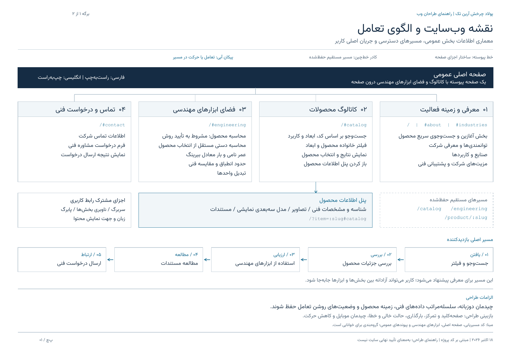
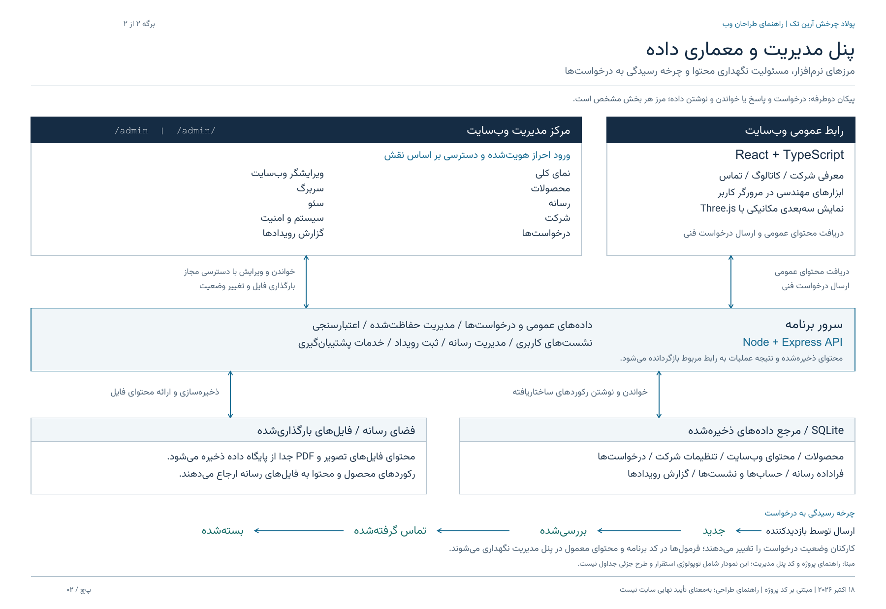

<div dir="rtl">

# پولاد چرخش آرین تک

**فارسی** | [English](README.md)

وب‌سایت دو‌زبانهٔ مهندسی صنعتی برای معرفی شرکت، مرور بیرینگ‌ها و قطعات، بررسی مشخصات فنی، نمایش مدل‌های تعاملی، استفاده از ابزارهای مهندسی و ارتباط با تیم فنی.

> **وضعیت پروژه:** هر دو دامنه فعال‌اند. زیرساخت تأیید صلاحیت محاسبات، محاسبهٔ دستی مستقل و قراردادهای پنل مدیریت تا مرحلهٔ C1-C منتشر شده‌اند. مراحل C1-D، C0-C و C3-A شامل ورودی عددی دو‌زبانه و تبدیل واحد اکنون مستقر شده‌اند. خطاهای lint صفر است؛ تأیید مهندسی، پذیرش نهایی و بخشی از بررسی‌های عملیاتی باز هستند.
>
> **مرجع کد:** شاخهٔ `main` در گیت‌هاب.
>
> **مبنای مرور:** ۱۸ اکتبر ۲۰۲۶، مطابق [گزارش وضعیت](docs/STATUS_REVIEW_2026-10-18.md) و [مدرک تکمیل C1-D](docs/C1D_QUALITY_GATE.md). این راهنمای فارسی، بخش‌های اصلی معرفی، وضعیت و کار با پروژه را پوشش می‌دهد؛ تاریخچهٔ تفصیلی در [README انگلیسی](README.md#development-history) نگهداری می‌شود.

**دسترسی:** [وب‌سایت فارسی](https://poladcharkhesh.ir/) · [وب‌سایت انگلیسی](https://poladcharkhesh.com/) · [پنل مدیریت](https://poladcharkhesh.ir/admin/) · [راهنمای نصب فارسی روی اوبونتو](docs/UBUNTU_24_GUIDE_FA.md)

**بستهٔ توسعهٔ C0-C — ۱۸ اکتبر ۲۰۲۶:** منابع سازنده با شمارهٔ صفحه، ویرایش و هش فایل بررسی شدند و آزمون‌های مستقل بار معادل، بار استاتیکی، درون‌یابی و قابلیت اطمینان اضافه شدند. مقادیر خارج از حد پایین جدول رد می‌شوند و محاسبهٔ رولربیرینگ بشکه‌ای کف‌گرد به سری SKF و وضعیت لنگیِ بررسی‌شده نیاز دارد. هر **۱۰۷ آزمون** موفق است. هنوز هیچ پروفایل محصولی تأیید نشده و پذیرش مهندسی، سیاست درون‌یابی و اعمال حدود مجاز شرایط کار باز هستند. این بسته همراه C3-A مستقر شده است. [شواهد و محدودیت‌ها](docs/engineering-tools/methods/C0C_EVIDENCE.md).

**C3-A — ورودی عددی و تبدیل واحد:** پشتیبانی از ارقام فارسی، عربی و لاتین و هشت گروه تبدیل دوطرفه تکمیل شد. ورودی خالی و نامعتبر، تفاوت دما و اختلاف دما، جابه‌جایی بدون گرد کردن و حفظ ورودی هنگام تغییر ابزار یا زبان بررسی شدند. **۱۲۰ آزمون** و بررسی مرورگر دو‌زبانه موفق است؛ lint بدون خطاست. مراحل C1-D/C0-C/C3-A روی هر دو دامنه مستقر شدند؛ تمام جدول‌ها و فایل‌های مالک بدون تغییر ماندند و پشتیبان فقط روی VPS نگهداری می‌شود؛ تأیید مهندسی همچنان باز است. [قرارداد ورودی و شواهد](docs/engineering-tools/C3A_INPUTS_UNITS.md).

**اصلاح ورود به ابزار مهندسی مستقر شد — ۲۰ اکتبر ۲۰۲۶:** در نبود محصول یا تأیید روش، فرم محاسبه دستی عمر مستقیماً نمایش داده می‌شود و توضیح دو‌زبانه، آن را از تأیید محصول جدا می‌کند. مقادیر کاتالوگ در فرم دستی کپی نمی‌شوند. بررسی زندهٔ فارسی و انگلیسی و هر ۱۲۰ آزمون موفق است؛ تأیید مهندسی همچنان باز می‌ماند. [اصلاح و شواهد انتشار](docs/engineering-tools/ENGINEERING_ENTRY_FIX_2026-10-20.md).

## نقشهٔ وب‌سایت و راهنمای طراحان

دو برگهٔ زیر برای معرفی ساختار پروژه به طراحان و توسعه‌دهندگان تهیه شده‌اند. برگهٔ اول بخش‌های عمومی، آدرس‌ها، پنل محصول و مسیر کاربر را نشان می‌دهد. برگهٔ دوم ارتباط پنل مدیریت، سرور، پایگاه داده و فایل‌های رسانه را توضیح می‌دهد.

**دریافت فایل‌ها:** [PDF دوصفحه‌ای فارسی](docs/designer-handoff/polad-charkhesh-designer-handoff-fa.pdf) · [نقشهٔ عمومی قابل‌ویرایش](docs/designer-handoff/01-public-sitemap-fa.svg) · [معماری مدیریت و دادهٔ قابل‌ویرایش](docs/designer-handoff/02-admin-data-architecture-fa.svg) · [راهنمای فارسی نمودارها](docs/designer-handoff/README.fa.md)

### نقشهٔ عمومی و مسیر کاربر

[](docs/designer-handoff/01-public-sitemap-fa.svg)

### پنل مدیریت و معماری داده

[](docs/designer-handoff/02-admin-data-architecture-fa.svg)

نمودارها از روی کد پروژه تهیه شده‌اند. گروه‌بندی آن‌ها برای خوانایی است؛ هر کادر یک صفحهٔ مستقل نیست و این مستندات به‌معنای تأیید نهایی عملکرد سایت نیستند.

## هدف و مسیر استفاده

این پروژه یک نمایشگاه فنی و وب‌سایت معرفی شرکت است. قیمت‌گذاری آنلاین، سبد خرید، تسویه‌حساب و پرداخت در دامنهٔ آن قرار ندارند.

۱. محصول را با کد، ابعاد یا کاربرد پیدا کنید.
۲. مشخصات، تصاویر و اطلاعات محصول را بررسی کنید.
۳. از ابزارهای مهندسی متناسب با داده‌ها و روش مجاز استفاده کنید.
۴. مستندات موجود را مطالعه کنید.
۵. برای بررسی نیاز فنی با شرکت تماس بگیرید یا درخواست ارسال کنید.

## وضعیت فعلی پروژه

بر اساس آخرین گزارش ثبت‌شده، کاتالوگ ۱۱۰ محصول دارد؛ ۱۰۱ تصویر جایگزین منتشر شده و هیچ پیوست PDF محصول در داده‌های فعلی ثبت نشده است. نسخهٔ منتشرشدهٔ برنامه در این مرور، commit زیر است؛ ثبت تغییر در گیت‌هاب به‌تنهایی سایت را مستقر نمی‌کند:

<div dir="ltr">

`bb0ef61b0bfc89077bacfe0dd113d52363c8af9f`

</div>

| بخش | وضعیت | توضیح |
| ---: | ---: | ---: |
| رابط عمومی و تجربهٔ دو‌زبانه | پیاده‌سازی شده | صفحهٔ پیوسته، هویت شرکت، چیدمان واکنش‌گرا و تغییر زبان موجود است؛ مرور نهایی دستگاه‌ها و برابری متن دو زبان باقی است. |
| هویت و داده‌های کاتالوگ | بررسی جزئی | ۱۱۰ هویت حفظ شده و ۶۱ اصلاح فنی منتشر شده است. آخرین بررسی: ۶۱ مورد جزئی، ۴۷ مورد مبهم و ۲ مورد مسدود؛ تأیید کامل سازنده انجام نشده است. |
| جست‌وجو و مقایسه | آزمون‌شده | جست‌وجو، فیلترهای وابستهٔ ابعادی، شمارش خانواده‌ها، پیوندهای قابل‌اشتراک و مقایسهٔ حداکثر سه محصول موجود است. |
| پنل محصول | پیاده‌سازی شده | تصویر، نقشه، نمای انفجاری، ابعاد، تماس، مستندات و محصولات مرتبط؛ رسانهٔ دقیق همهٔ کدها هنوز کامل نیست. |
| نمایش سه‌بعدی | پیاده‌سازی شده | مدل متحرک با مسیرهای جایگزین سازگاری مرورگر؛ هندسهٔ داخلی، نمایش آموزشی است و معادل CAD سازنده نیست. |
| عملکرد بارگذاری | منتشر و بررسی شده | انتخاب یک موتور گرافیکی پیش از دانلود، فونت فشرده، تصاویر واکنش‌گرا و حذف بارگذاری تکراری؛ [شواهد](docs/PERFORMANCE_2026-10-14.md). |
| ابزارهای مهندسی | C3-A مستقر شده؛ تأیید مهندسی باز است | محاسبات محصول به پروفایل روشِ بررسی‌شده و جاری نیاز دارند. منابع و آزمون‌های حسابی آماده‌اند؛ تأیید مهندسی و اعمال محدودهٔ شرایط کار باقی است. هنوز پروفایل تولیدی تأییدشده‌ای ثبت نشده؛ محاسبهٔ دستی مستقل است. |
| API و پایگاه داده | آزمون‌شده | محصولات، تنظیمات، درخواست‌ها، حساب‌ها، فرادادهٔ رسانه و گزارش رویدادها در SQLite نگهداری می‌شوند. |
| احراز هویت و نقش‌ها | آزمون‌شده | نشست سرور، راه‌اندازی اولیه، API حفاظت‌شده و بررسی نقش‌ها موجود است. |
| ویرایش محتوا و محصولات | پیاده‌سازی شده | ویرایش دو‌زبانه، فیلتر کمبود محتوا، عملیات گروهی و ورود/خروج JSON بررسی‌شده؛ پذیرش کامل همهٔ گردش‌های مدیریت باقی است. |
| رسانه | بررسی هدفمند در محیط عملیاتی | بارگذاری، دریافت و حذف آزمایشی تصویر و PDF و بررسی ذخیره‌سازی پایدار انجام شده است؛ پذیرش کامل گردش کار باقی است. |
| درخواست‌ها و رویدادها | آزمون‌شده | ثبت درخواست، تغییر وضعیت و ثبت رویدادهای مدیریتی موجود است. |
| پشتیبان‌گیری و بازیابی | بررسی‌شده در محدودهٔ ثبت‌شده | نسخهٔ پشتیبان VPS، بازیابی ایزوله و بازیابی سرویس آزموده شده‌اند. آزمون راه‌اندازی مجدد کل میزبان جداست؛ پشتیبان‌ها طبق دستور مالک فقط روی VPS می‌مانند. |
| سئوی فنی | بررسی‌شده؛ نمایه‌سازی متوقف | هر دو دامنه در ۱۸ اکتبر با `noindex, nofollow` پاسخ می‌دهند. تأیید نمایه‌سازی و تنظیمات Search Console هنوز باقی است. |
| تصاویر و مستندات | ناقص | ۵۸ تصویر مطابق فهرست تأمین‌کننده و ۴۳ نمونهٔ تأییدشده؛ ۹ جایگزینی دقیق حل نشده است. برچسب تصویری حذف شده، اما منابع و اعتبار تصاویر باقی‌اند. |
| کیفیت کد | C1 در کد کامل است | در مرحلهٔ C1-D، خطاهای lint از ۱۹۷ به صفر رسیده و lint در CI الزامی شده است؛ هیچ قاعده‌ای تضعیف نشده است. |
| بررسی خودکار | فعال | بررسی نوع‌ها، آزمون‌ها، build، بودجهٔ بسته‌ها و smoke مستقل اجرا می‌شوند؛ lint ناموفق، گردش CI را ناموفق می‌کند. |
| استقرار | C1-D/C0-C/C3-A منتشر شده | ۱۲۰ آزمون، lint الزامی، ساخت و smoke روی ویندوز، اوبونتو و CI موفق است؛ هش داده‌های مالک حفظ شد. [شواهد انتشار](docs/engineering-tools/C3A_INPUTS_UNITS.md). |
| پذیرش نهایی | باز | بررسی جامع مرورگر، دسترس‌پذیری، امنیت، محتوای فنی و وضعیت عملیاتی هنوز تکمیل نشده است. |

استقرار جاری شامل C1-D، C0-C و C3-A است و ۱۲۰ آزمون موفق دارد. مرحلهٔ مستقل بعدی C3-B، کاربرگ دستی عمر هدف و فرضیات نتیجه است؛ تصمیم‌های هویت محصول و تأیید مهندس همچنان باز می‌مانند.

## ساختار صفحهٔ عمومی و آدرس‌ها

تجربهٔ اصلی روی یک صفحهٔ پیوسته قرار دارد: معرفی شرکت، کاتالوگ جست‌وجوپذیر، ابزارهای مهندسی، صنایع و تماس. مشخصات و مستندات محصول در یک پنل شناور باز می‌شوند. سربرگ و دکمه‌های اصلی کاربر را به بخش مربوط هدایت می‌کنند.

| مسیر | کاربرد |
| ---: | ---: |
| `/` | صفحهٔ عمومی اصلی |
| `/#about` و `/#industries` | معرفی و صنایع |
| `/#catalog` | کاتالوگ درون صفحه |
| `/#engineering` | فضای ابزارهای مهندسی |
| `/#contact` | اطلاعات تماس و فرم درخواست |
| `/?item=6204-2rs#catalog` | انتخاب محصول با پیوند قابل‌اشتراک |
| `/catalog` و `/engineering` | مسیرهای مستقیم حفظ‌شده برای دسترسی و نشانی‌های قبلی |
| `/product/:slug` | صفحهٔ مستقیم جزئیات محصول |
| `/admin` و `/admin/` | پنل مدیریت با ورود کارکنان مجاز |

فیلترهای کاتالوگ می‌توانند در آدرس ذخیره شوند؛ برای نمونه `/?q=6204#catalog` یا `/?d=20&D=47#catalog`. پیوندهای قدیمی ذخیره‌شده در CMS هنگام نمایش عمومی به مقصد مناسب در صفحهٔ پیوسته تبدیل می‌شوند.

## پنل مدیریت و محتوا

بخش‌های پنل عبارت‌اند از: **نمای کلی، محصولات، رسانه، شرکت، درخواست‌ها، ویرایشگر وب‌سایت، سربرگ، سئو، سیستم و امنیت و گزارش رویدادها**.

مدیر می‌تواند مشخصات محصول را ویرایش کند، از محصول پیش‌نویس جدید بسازد، وضعیت ویژه را تغییر دهد، تصویر و مستندات پیوست کند و رکوردها را بایگانی یا بازیابی کند. حذف دائمی به بایگانی قبلی، دسترسی مدیر ارشد و تأیید متنی نیاز دارد. تکثیر، پیش‌نویس قابل‌بررسی می‌سازد و رکورد اصلی را تغییر نمی‌دهد.

ویرایشگر دو‌زبانه برای عنوان‌ها، توضیحات، ترتیب و نمایش بخش‌ها، کارت‌ها، ناوبری، رنگ‌ها و تصاویر به کار می‌رود. اطلاعات شرکت، شماره‌های تماس، لوگو، سربرگ و سئو کنترل‌های جدا دارند. فرمول‌های مهندسی و کد دلخواه صفحه از طریق این ویرایشگر تغییر نمی‌کنند.

### درخواست‌ها، رسانه و پشتیبان‌ها

ترتیب رسیدگی به درخواست: **جدید ← بررسی‌شده ← تماس گرفته‌شده ← بسته‌شده**. تغییر وضعیت توسط کارکنان انجام می‌شود؛ ثبت یک وضعیت به‌معنای تماس خودکار با کاربر نیست.

فایل‌های واقعی تصویر و PDF در `data/uploads` ذخیره می‌شوند و فرادادهٔ آن‌ها در SQLite قرار می‌گیرد. حذف رسانه‌ای که هنوز در محتوا استفاده می‌شود رد خواهد شد.

نسخهٔ پشتیبان JSON شامل کاتالوگ، محتوا و تنظیمات، درخواست‌ها و فرادادهٔ رسانه است؛ رمزها، نشست‌ها و محتوای فایل‌های بارگذاری‌شده را شامل نمی‌شود. پشتیبان کامل به نگهداری امن پایگاه داده و فایل‌ها نیز نیاز دارد. [راهنمای مدیریت](docs/ADMIN.md)

## معماری و مرجع داده

- **رابط کاربری:** React 19، TypeScript، Vite و Three.js؛ با پشتیبانی فارسی/انگلیسی و راست‌به‌چپ/چپ‌به‌راست.
- **سرور:** Node و Express؛ همراه با اعتبارسنجی، نشست سرور، کوکی HttpOnly امضاشده، کنترل دسترسی و ثبت رویداد.
- **دادهٔ معتبر هنگام اجرا:** SQLite مرجع محصولات و محتوای ذخیره‌شده است. کاتالوگ اولیه برای راه‌اندازی جدول جدید استفاده می‌شود؛ تغییرات مدیر نباید با دادهٔ اولیه بازنویسی شوند.
- **فایل‌های محلی:** پایگاه داده در `data/platform.sqlite` و رسانه در `data/uploads`؛ این داده‌ها و اطلاعات محرمانه وارد گیت نمی‌شوند.
- **میزبانی:** برنامهٔ Node/SQLite روی VPS موجود اجرا می‌شود. این بسته برای اجرای Cloudflare Worker نیست؛ push به گیت‌هاب، استقرار خودکار محسوب نمی‌شود.

[معماری](docs/ARCHITECTURE.md) · [مدل داده](docs/DATA_MODEL.md) · [رویهٔ استقرار](docs/DEPLOYMENT.md)

## اصول فنی و طراحی

هویت محصول، نام سازنده، ابعاد، ظرفیت بار، سرعت‌ها، کاربرد و منابع باید با شواهد معتبر نگهداری شوند. مدل سه‌بعدی از ابعاد کاتالوگ استفاده می‌کند، اما جزئیات داخلی مثل قفسه و مسیر غلتش نمایشی‌اند. تأیید هندسه به‌معنای تأیید روش محاسبه نیست.

تولیدکنندهٔ PDF موجود، خلاصهٔ شرکتی می‌سازد، نه سند صادرشده از سازنده. تولید دیتاشیت شرکتی تأییدشده به پذیرش فنی کاتالوگ وابسته است. تصاویر نمونه یا تصاویر فهرست تأمین‌کننده به‌تنهایی هویت دقیق قطعه را اثبات نمی‌کنند.

برای ۴۲ ردیف SKF افزوده‌شده، نام‌گذاری «سرعت مرجع» و «سرعت حدی» حفظ می‌شود؛ این مقادیر نباید بدون شاهد به سرعت گریس یا روغن تغییر معنا دهند. موارد نامشخص از قبیل قفسه، لقی یا کاربرد نباید با حدس پر شوند. وجود محصول در کاتالوگ به‌معنای موجودی انبار نیست. [مبانی محاسبات](docs/ENGINEERING_CALCULATIONS.md)

سایت از لوگوی شرکت، فونت میزبانی‌شدهٔ IRANSans، رابط آبی تیره و جزئیات فلزی محدود استفاده می‌کند. رنگ‌ها از پنل قابل‌تنظیم‌اند. زبان پیش‌فرض دامنهٔ `.ir` فارسی و دامنهٔ `.com` انگلیسی است؛ کاربر می‌تواند زبان را تغییر دهد. نمودارهای فارسی این راهنما از فونت آزاد وزیرمتن استفاده می‌کنند.

## برنامهٔ تکمیل و شواهد اخیر

| مرحله | نتیجهٔ ثبت‌شده | مرجع |
| ---: | ---: | ---: |
| شروع COMPLETE-01 | برنامهٔ مرحله‌ای، ماتریس اولیهٔ ۱۱۰ محصول و اصلاح اعتبارسنجی عددی؛ ۷۵ آزمون بسته | [برنامهٔ تکمیل](docs/COMPLETION_PLAN.md) |
| C0-B / C1-A | استقلال تأیید محاسبات از هندسه و ابزار دستی از محصول؛ ۸۳ آزمون و کاهش lint به ۱۷۶ | [گزارش تحویل](docs/engineering-tools/foundation/C0B_C1A_DELIVERY.md) |
| C1-B | قرارداد صریح API و داده، اعتبارسنجی کامل ورود و بازیابی؛ ۸۹ آزمون و کاهش lint به ۱۳۱ | [قراردادهای API](docs/C1B_API_CONTRACTS.md) |
| C1-C | نوع‌های مشترک و حفظ فیلدهای تو‌در‌تو؛ ۹۳ آزمون، lint برابر ۶۳ و انتشار روی سرور | [گزارش انتشار](docs/C1C_ADMIN_CLIENT_RELEASE.md) |
| C1-D | صفر خطای lint و الزام آن در CI؛ ۹۵ آزمون و بررسی‌های هدفمند؛ همراه C3-A مستقر شده | [دروازهٔ کیفیت](docs/C1D_QUALITY_GATE.md) |
| C0-C | منابع روش‌ها و آزمون‌های مستقل؛ اصلاح حدود جدول و روش کف‌گرد؛ ۱۰۷ آزمون، TypeScript، lint، build و smoke موفق؛ همراه C3-A مستقر شده | [بستهٔ شواهد](docs/engineering-tools/methods/C0C_EVIDENCE.md) |

کارهای باقی‌مانده:

1. دریافت تأیید مهندس برای بستهٔ آمادهٔ C0-C، سیاست درون‌یابی و محدودهٔ شرایط کار؛ هنوز هیچ پروفایل محاسبهٔ محصول تأیید نشده است. مرحلهٔ مستقل بعدی C3-B، کاربرگ دستی عمر هدف و فرضیات نتیجه است.
2. حل ۹ تصویر باقی‌مانده، بررسی هویت ۴۳ تصویر نمونه و تأمین مستندات محصول؛ تولید دیتاشیت پس از پذیرش فنی.
3. حفظ دروازهٔ کیفیت در توسعهٔ بعدی؛ انتشار C1-D/C0-C/C3-A با نسخهٔ مشخص انجام شد.
4. پذیرش جامع نقش‌ها، بازیابی، درخواست‌ها، رسانه، امنیت، دسترس‌پذیری، متن دو زبان و نمایش روی رایانه، تبلت و موبایل.
5. بازبینی وضعیت پراکسی و گواهی لبهٔ Cloudflare، شبکهٔ میزبان، راه‌اندازی مجدد کامل و سیاست نگهداری پشتیبان؛ مطابق محدودیت نگهداری روی VPS.
6. تصمیم صریح دربارهٔ حذف `noindex` پس از پذیرش محتوا و انتشار، سپس بررسی Search Console و نقشهٔ سایت.
7. پیاده‌سازی توسعهٔ متوازن ابزارهای انتخاب، محاسبات، روانکاری و نگهداری مطابق [برنامهٔ جعبه‌ابزار مهندسی](docs/engineering-tools/PROJECT_PLAN.md). بخش‌های توسعه‌یافته هنوز پیاده‌سازی نشده‌اند.

استقرار اولیه، بازیابی ایزوله و بازیابی پس از توقف سرویس قبلاً انجام شده‌اند. انتشارهای بعدی همچنان بررسی، پشتیبان، نسخهٔ دقیق و مسیر بازگشت خود را لازم دارند.

## اجرای محلی

نیازمندی‌ها: Node.js نسخهٔ **22.16 یا جدیدتر** و pnpm؛ Node 24 پیشنهاد پروژه است.

<div dir="ltr">

```bash
pnpm install --frozen-lockfile
pnpm dev
```

</div>

[وب‌سایت محلی](http://127.0.0.1:5173/) و [پنل مدیریت محلی](http://127.0.0.1:5173/admin/) در دسترس خواهند بود؛ API روی `http://127.0.0.1:3001` اجرا می‌شود. پایگاه دادهٔ تازه، ساخت مدیر اولیه را درخواست می‌کند و اطلاعات ورود پیش‌فرض ندارد. رمز باید دست‌کم ۱۲ نویسه داشته باشد؛ محیط عملیاتی به توکن راه‌اندازی سمت سرور نیز نیاز دارد.

بررسی‌های پروژه:

<div dir="ltr">

```bash
pnpm lint
pnpm typecheck
pnpm test
pnpm build
pnpm check:bundles
pnpm smoke:production
```

</div>

فایل `.env`، پایگاه داده، رسانهٔ خصوصی، نسخه‌های پشتیبان و اطلاعات ورود را commit نکنید. مخزن شامل کد و دارایی‌های عمومی بسته است، نه محتوای خصوصی سایت در حال اجرا. [گردش کار گیت‌هاب](docs/GITHUB.md)

## نگهداری مستندات و قواعد توسعه

پیش از تغییر، آخرین `main` و کارهای فعال بررسی شوند. داده‌های فنی و هویت محصولات حفظ شوند؛ تغییر ضروری و محدود انجام شود، بررسی متناسب اجرا شود و وضعیت مستندات در همان commit به‌روز گردد.

با تغییر وضعیت، قابلیت‌ها، دستورات یا نقشهٔ راه، **README فارسی و انگلیسی را هم‌زمان بازبینی کنید**. تاریخ مرور و شواهد را به‌روز کنید؛ پیاده‌سازی یک قابلیت به‌تنهایی مجوز استفاده از برچسب «تأییدشده» نیست. تغییرات صرفاً مدیریتی در پایگاه داده ذخیره می‌شوند و README را خودکار تغییر نمی‌دهند.

ورودی‌های تاریخی بیان وضعیت زمان خود هستند؛ برای وضعیت امروز از گزارش فعلی و برنامهٔ باقی‌مانده استفاده کنید. [تاریخچهٔ کامل توسعه](README.md#development-history) · [مرور وضعیت](docs/STATUS_REVIEW_2026-10-18.md) · [راهنمای سئو](docs/SEO.md) · [چک‌لیست میزبانی فارسی](docs/HOSTING_CHECK_FA.md)

</div>
