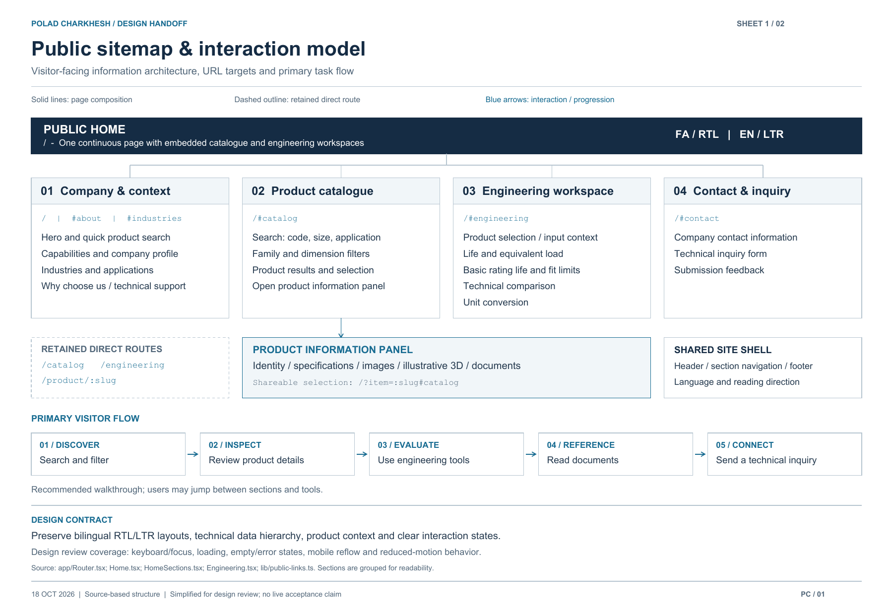
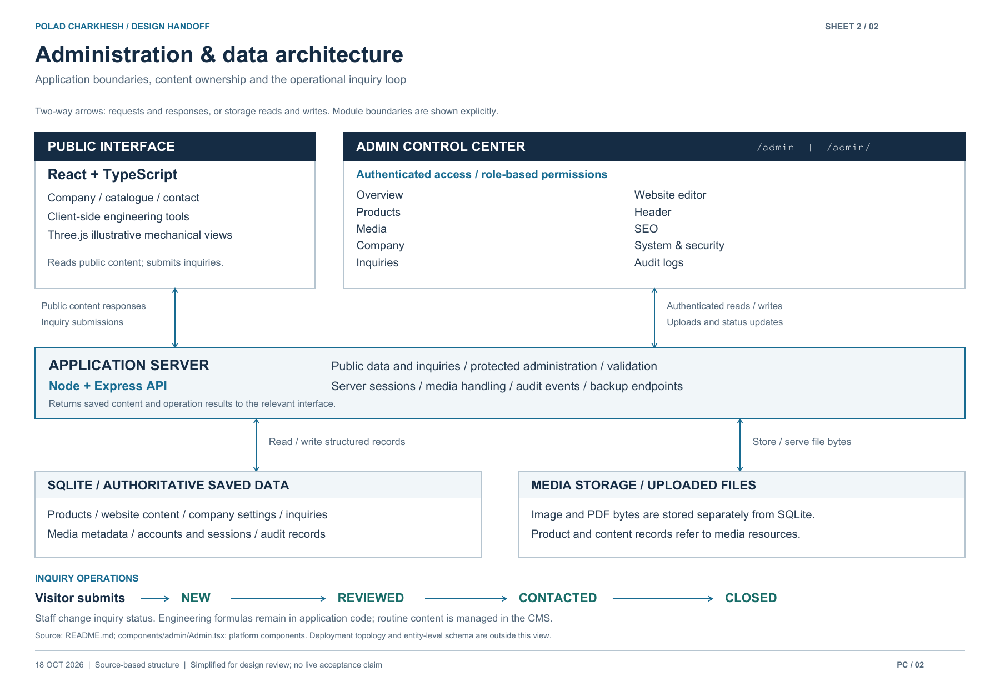

# Polad Charkhesh Arian Tech — پولاد چرخش آرین تک

> **Project status:** Both language domains live with trusted HTTPS; English Cloudflare proxy activation and final acceptance remain open
>
> **Source of truth for code:** GitHub `main`
>
> **Last status review:** 2026-10-15

Polad Charkhesh Arian Tech is a bilingual Persian/English industrial engineering website for presenting the company, bearings, technical product information, documents, interactive models, and engineering tools.

**Engineering toolbox expansion — planning:** [Project definition, phased plan and backlog](docs/engineering-tools/PROJECT_PLAN.md) cover a balanced expansion of selection, calculations, lubrication and maintenance. Implementation and deployment have not started.

**Exact-image follow-up published — 2026-10-18:** NTN 5206S now has a matching supplier photograph of the bearing and marked box. Image replacements total 101; nine unresolved entries remain unchanged under the owner's exact-match-only instruction. [Follow-up evidence and deployment checks](docs/CATALOG_DEPLOYMENT_2026-10-18.md).

**Catalog update published — 2026-10-15:** The owner-authorized update applied 61 technical-record patches and 100 product-image replacements across the existing 110-product catalog. Images include 57 supplier-listing matches and 43 clearly labeled examples; ten unresolved images remain unchanged. [Deployment and verification record](docs/CATALOG_DEPLOYMENT_2026-10-15.md). Manufacturer evidence gaps and final engineering acceptance remain open before company datasheet PDFs; publication does not establish exact photographed-unit verification.

**Live Persian website:** [poladcharkhesh.ir](https://poladcharkhesh.ir/) · [Admin login](https://poladcharkhesh.ir/admin/). Cloudflare proxying, Full (strict), a valid origin certificate and automatic renewal are active. The existing 110-product catalog and owner account were preserved. The [temporary IP origin](https://213.176.28.119/) remains available. Indexing remains gated by final content/audit acceptance. [Deployment evidence and remaining checks](docs/VPS_DEPLOYMENT_2026-10-14.md).

**Live English website:** [poladcharkhesh.com](https://poladcharkhesh.com/) · [Admin login](https://poladcharkhesh.com/admin/). The registrar NS blocker is resolved. Independent apex/www HTTPS and its renewal dry-run passed; `.com` defaults to English and `.ir` to Persian. English Cloudflare Full (strict) is saved; records remain DNS only while its edge certificate finishes validation; the zone is now active. [Activation evidence](docs/ENGLISH_DOMAIN_2026-10-15.md).

**Install from GitHub on Ubuntu 24.04:** [English instructions](docs/GITHUB_VPS_INSTALL.md) · [راهنمای کامل فارسی](docs/UBUNTU_24_GUIDE_FA.md). The repository includes the admin panel and API. The first-install helper builds a pinned source revision and supports private owner-data restoration or an explicitly new database; its default HTTPS workflow is restricted staging. Credentials, databases and uploaded files must remain outside GitHub. The existing VPS has now been published using the separate deployment recorded above; do not rerun the first-install helper on it.

This is **not an online shop**. There are no prices, carts, checkout, payments, or Buy Now flows. The intended visitor journey is:

**Find a product → Review its specifications → Explore engineering guidance → Read its documents → Contact Polad Charkhesh Arian Tech**

---

## Current project status

The main feature set is published on both language domains and the temporary VPS address. Owner-authenticated administration, an unchanged-settings save on the real Persian origin and targeted Persian mobile preview checks passed. The current work is to **verify manufacturer data and content, complete final audits, and complete English Cloudflare edge activation**. Successful deployment checks do not mean manufacturer data and every browser workflow have been approved.

| Area | Status | What this means now |
| --- | --- | --- |
| Public website and industrial visual system | 🟢 Implemented | Responsive dark glass design, company branding, and a unified single-page public journey are in place; final device review remains. |
| Persian/English experience | 🟢 Implemented | RTL/LTR and language switching exist; final copy parity needs review. |
| Canonical product seed | ✅ Verified in tests | All 68 legacy identities are preserved, and 42 SKF sealed deep-groove designations bring the bundled catalog to 110 records. Current SKU verification remains a launch task. |
| Catalog search and product comparison | ✅ Verified in tests | Search-first catalog with optional dependent size filters, active-filter chips, live family counts and shareable filtered URLs; up to three-product comparison remains in the engineering workspace. |
| Product specifications and documents | 🟢 Implemented | Floating panels show image/drawing/exploded controls, key dimensions and contact actions alongside switchable specifications, documents and related components. Related navigation updates the URL and preserves dialog focus. Exact SKU media are incomplete. |
| Animated bearing visuals | 🟢 Implemented | A full-width 3D banner randomly picks a bearing on each page load, with desktop companion bearings and presentation-speed controls. Older Safari can use a lazy WebGL 1 engine with the same model geometry, studio and motion logic; an animated SVG remains the last recovery path. Assembled mode follows scrolling; Exploded view stays fixed. The global bearing background and hero family buttons are removed. Bilingual typing headlines are editable in Admin. Product panels retain separate product-specific geometry. Models are illustrative. |
| Loading performance | ✅ Published and checked | One GPU engine selected before download, compressed company fonts, responsive family photos and no redundant startup data refresh. Same 3D geometry and owner media retained. [Measurements](docs/PERFORMANCE_2026-10-14.md). |
| Engineering workspace | 🟢 Implemented | Life and known-load estimates show example results immediately and recalculate as inputs change. Fit limits, comparison, and unit conversion remain on the homepage; application review remains essential. |
| Express API and SQLite persistence | ✅ Verified in tests | Products, settings, inquiries, accounts, media metadata, and audit records persist locally. |
| Admin authentication and roles | ✅ Verified in tests | Server sessions, first-run setup, protected APIs, and role checks are implemented. |
| Admin content and product editing | 🟢 Implemented | Product editing, missing-content filters, bulk actions and reviewed JSON import/export are implemented and tested. SEO previews and saving were reviewed in an isolated browser session; full media, roles and restore UI review remains. |
| Physical media upload | 🟢 Implemented | PNG, JPEG, WebP, and PDF upload/delete are supported; production storage and backup need checking. |
| Inquiry and audit workflows | ✅ Verified in tests | Inquiries persist with status changes; audit events are recorded. |
| Backup and restore | 🟢 Implemented | Admin JSON export/restore is tested. A separate verified SQLite-and-uploads backup command is ready for an offline server backup; a live-host restore drill remains. |
| Technical SEO | ✅ Verified locally and on `.ir` | 113 routes pass bilingual content and production HTTP checks. Shared breadcrumbs, LocalBusiness/Product schema, canonical/hreflang, robots, sitemap, llms.txt, branded 404, favicon and alt-text improvements are implemented. [Checklist and evidence](docs/SEO_PREDEPLOY_CHECKLIST.md). English Cloudflare edge activation and indexing approval remain pending. |
| Exact product photos and manufacturer PDFs | 🟡 Pending content | Exact SKU photos are still missing. SKF's public product/image hosts blocked reliable access, so the 42 new records use clearly labeled family-reference visuals and link to SKF's official catalog. Admin uploads can replace each image later. |
| Full browser, accessibility, and security audit | 🟡 Pending | Targeted checks exist, but a final end-to-end production review has not been completed. |
| Repository lint | 🟡 In progress | Tooling now uses the platform TypeScript configuration and Vite-appropriate rules. Current count is 197 findings; new compatibility/fallback files pass targeted lint, but repository lint still fails and remains a launch blocker. |
| Automated source checks | 🟢 Configured | GitHub Actions runs type checks, regression tests, build and isolated production smoke checks on main pushes and pull requests. Lint is reported explicitly as advisory while the backlog remains. Branch protection and deployment approval are separate. |
| VPS deployment and production smoke test | 🟡 Both domains live; final acceptance open | Existing owner data published on both language-domain HTTPS origins and the temporary IP. All 64 source tests, 226 live language/page checks, owner-authenticated admin workflows, Persian mobile preview, certificate renewal, restore drill and real service crash recovery passed. The owner confirmed Safari content and intermediate animation recovery; the owner also confirmed the published 3D model appears and moves on Safari. English Cloudflare edge activation, host reboot, lint/content and full audit remain open. [Deployment evidence](docs/VPS_DEPLOYMENT_2026-10-14.md). |

**Legend:** ✅ verified in an applicable test or check · 🟢 implemented, with final review remaining · 🟡 pending work or validation · ⬜ not started · 🔴 blocked.

The latest loading-performance update passed **64 tests** on Windows and Ubuntu 24.04; its external check passed 226 page/language variants. [Payload comparisons and publication evidence](docs/PERFORMANCE_2026-10-14.md). The earlier Safari recovery update passed **59 tests**. TypeScript, production build, JavaScript size budgets and isolated production smoke passed for the recovery update. The published-content SEO audit covers **110 products, 113 routes and 226 language variants** with zero automated findings. Targeted checks cover breadcrumbs, 404, preserved animation, Persian mobile product/exploded views, legacy browser capabilities and section failure recovery. The owner confirmed the phone no longer loses its content; the owner also confirmed the same 3D model appears and moves on Safari after the compatibility update. The final accessibility, security and product-data review remains open. See [mobile recovery evidence](docs/MOBILE_RECOVERY_2026-10-14.md), the [quality report](docs/QUALITY_PHASE_2026-10-13.md) and [SEO checklist](docs/SEO_PREDEPLOY_CHECKLIST.md).

## Website map and designer handoff

The two-sheet designer handoff explains the public information architecture, routes and product interactions, followed by the administration modules and data flow. It distinguishes sections of the continuous home page from retained direct routes and shows how the public interface and admin panel use the server, SQLite and uploaded media.

**Downloads:** [Two-page PDF](docs/designer-handoff/polad-charkhesh-designer-handoff.pdf) · [Editable public sitemap (SVG)](docs/designer-handoff/01-public-sitemap.svg) · [Editable admin/data architecture (SVG)](docs/designer-handoff/02-admin-data-architecture.svg) · [Handoff notes and regeneration instructions](docs/designer-handoff/README.md).

### Public sitemap and visitor flow

[](docs/designer-handoff/01-public-sitemap.svg)

### Administration and data architecture

[](docs/designer-handoff/02-admin-data-architecture.svg)

These source-based diagrams were prepared on 18 October 2026 for design review. They group related features for readability and do not replace live acceptance testing or an entity-level database schema.

---

## Public site layout

The primary visitor experience is one continuous page at `/`: company introduction, full searchable catalog, product specifications and documents in a floating panel, mechanical engineering reference tools, industries, and contact. The header and major calls to action jump to these sections instead of opening separate catalog or engineering pages. The catalog shows two complete product rows and a faded preview of the third, then reveals more on request. Family filters form one horizontal row, and text search covers codes, dimensions and applications. Optional dimension selectors offer compatible sizes, and removable filter chips keep active constraints visible. Product selection in the engineering heading supplies the calculation context. Product-specific geometry remains available in the product specifications experience. Existing `/catalog`, `/engineering`, and `/product/:slug` URLs remain available for old bookmarks and indexing.

Shareable one-page links include `/#catalog`, `/?q=6204#catalog`, `/?d=20&D=47#catalog`, `/?item=6204-2rs#catalog`, and `/?product=6204-2rs#engineering`. The admin website preview offers these same section views. Previously saved CMS links to the old catalog, engineering, and product paths are translated to their one-page targets when shown publicly.

---

## Admin and CMS status

The admin panel is a website control center at [`/admin/`](http://127.0.0.1:5173/admin/). Both `/admin` and `/admin/` are supported. A new database shows **Create administrator**; there are no default credentials. Administrator accounts are local runtime data and are not stored in GitHub.

Its current modules are Overview, Products, Media, Company, Inquiries, Website editor, Header, SEO, System & security, and Audit logs.

### Product management

Administrators can:

- Create and edit product identity, specifications, applications, sources, and technical fields.
- Start a new product draft from an existing record, then enter a new code and slug and review its technical fields before saving.
- Toggle a product's featured status from the catalog list.
- Set featured/availability fields and attach a gallery image or PDF document.
- Archive and restore records; permanent deletion requires an archived record, a super-admin, and typed confirmation.

The 68 legacy products remain unchanged; 42 SKF catalog entries are added once to existing databases without overwriting admin edits or archived records. Future edits live in SQLite. Duplication does not alter the source record or silently create a catalog item: it opens a reviewable draft.

### Website content and company settings

The bilingual editor covers major homepage sections, their order and visibility, custom sections, cards, navigation, public text, brand colors and images, and a preview before saving. Header, company/contact information, product records, and SEO each have dedicated controls.

Routine changes to company identity, addresses, phone/WhatsApp/email, headings, descriptions, logos, and imagery can be made without editing source code. Public components should use that saved content instead of duplicating it. Engineering formulas and arbitrary page code cannot be changed in the panel.

### Inquiries, media, and backups

Inquiries follow **New → Reviewed → Contacted → Closed**. The Media module stores actual uploaded image/PDF files under `data/uploads` and keeps their metadata in SQLite. Product and website editors can select uploaded media. Deletion is refused while a file is still referenced.

Backup JSON includes catalog, content/settings, inquiries, and media metadata. It excludes passwords, sessions, and the uploaded file bytes. A complete backup must also copy `data/uploads` and preserve the SQLite database with a safe database backup procedure. See the [admin guide](docs/ADMIN.md).

---

## Architecture and data authority

- **Frontend:** React 19, TypeScript, Vite, Three.js, responsive Persian/English and RTL/LTR UI.
- **Backend:** Express on Node, SQLite, server-side sessions, signed HttpOnly cookies, protected admin endpoints, validation, and audit logging.
- **Runtime data:** SQLite is authoritative for saved products and website content. The bundled catalog seeds a newly created product table; the one-time SKF expansion inserts missing records into existing databases without overwriting admin edits.
- **Local paths:** `data/platform.sqlite` for the database and `data/uploads` for uploaded files. Both are excluded from Git.

The current Node/SQLite application is prepared for a VPS. It is not a Cloudflare Worker deployment. Pushing source to GitHub does not publish the site. See [architecture](docs/ARCHITECTURE.md), [data model](docs/DATA_MODEL.md), and [deployment preparation](docs/DEPLOYMENT.md).

## Product and engineering principles

Products are engineering catalog entries, not retail merchandise. A product may include designation, family, manufacturer reference, dimensions, load/speed ratings, applications, source notes, gallery images, and documents.

The 3D views use catalog dimensions and vary rolling-element types, but raceways, cages, and internal details are illustrative estimates rather than manufacturer CAD. The generated PDFs are Polad Charkhesh Arian Tech summaries of imported records, **not manufacturer-issued documents**. Family reference images are labeled and are not exact-SKU photographs. Basic bearing-life and fit results are guidance, not a substitute for manufacturer selection or review of operating conditions. See [engineering calculations](docs/ENGINEERING_CALCULATIONS.md).

The 42 new SKF entries are transcribed from the [official SKF sealed single-row deep-groove table, section 1.2](https://cdn.skfmediahub.skf.com/api/public/0901d1968063464b/pdf_preview_medium/0901d1968063464b_pdf_preview_medium.pdf). The table reports **reference** and **limiting** speed, which the site displays under those names rather than treating them as grease/oil-specific ratings. Blank cage, clearance, and application fields remain blank where this source did not identify them. These records are catalog references, not a claim that Polad Charkhesh Arian Tech stocks each variant.

## Design and language direction

The site uses the company-supplied logo and self-hosted **IRANSans** font, with a dark blue glass interface and restrained metallic accents. The brand colors are configurable in the admin editor. Persian is the default on `.ir`, English on `.com`, and visitors can switch language manually. New content should remain readable and usable in both directions.

## Business rules

Keep the public experience focused on company presentation, technical discovery, and direct consultation. Do not add online prices, a cart, checkout, payment, Buy Now, or retail purchasing flows. Product accuracy and clear explanations matter more than adding new visual features.

---

## Development history

- **2026-09-08 — Foundation:** Built the public site, migrated the 68-product seed, added Express/SQLite, server-side admin authentication, editing, inquiries, backups, and initial engineering tools.
- **2026-09-08 — Bearing experience:** Added liquid-glass styling, animated families, exploded views, double-row spherical rollers, and product-aware 3D Bearing Explorer models.
- **2026-09-09 — Showroom and engineering:** Added code/dimension search, bookmarkable filters, comparison, product media/PDF support, fit-limit exploration, and manufacturer reference links.
- **2026-09-09 — Presentation refinement:** Improved homepage accessibility, image sizing, cards, and dark visual details.
- **2026-09-28 — Admin route repair:** Made `/admin/` resolve to the same admin page as `/admin`; type checking and production build passed.
- **2026-09-28 — Project documentation:** Established this status dashboard and a same-commit README update practice.
- **2026-09-28 — Family showcase and Explorer:** Expanded Precision in Motion to ball bearings, roller bearings, bearing accessories, engineered products, and track rollers. Added an assembled/exploded control to the product-specific Bearing Explorer, with labeled assemblies and paused rotation during inspection.
- **2026-09-29 — Admin control center integration:** Compared the separate `PoladCharkhesh-local` admin and brought its useful dashboard and product-management patterns into this panel: grouped icon navigation, catalog and activity metrics, duplicate-as-draft, featured shortcut, and grouped bilingual company fields. The separate database and credentials were not imported because its catalog has unresolved differences.
- **2026-09-29 — Unified public page:** Brought the complete catalog, product specifications/documents, and the mechanical engineering reference tools into the homepage. Updated navigation, CTAs, saved-link compatibility, and admin preview targets to use section links. Retained legacy URLs for existing bookmarks. Removed horizontal overflow in English and Persian layouts.
- **2026-09-29 — Showroom refinement:** Moved product details into a compact image-and-specification panel, simplified the catalog to horizontal family filters and a two-row preview, and placed product selection beside the engineering heading. Removed the illustrative Thermal view because it did not calculate a defensible operating temperature.
- **2026-09-29 — Product specification actions:** Added an exploded view option to the floating product gallery and a direct exploded-view entry on full product pages for supported bearing models. Replaced the separate technical-inquiry action on full specifications with the existing product-specific engineering tools path; components without an applicable 3D assembly explain that limitation.
- **2026-09-29 — Product call choices:** Replaced the product specifications' engineering shortcut with direct mobile and central-office call actions in both the floating panel and full product pages. The numbers follow admin-managed company settings; the engineering workspace remains available from the main page.
- **2026-09-29 — Live engineering tools:** Removed the redundant Bearing Explorer and Clearance guide from section 03. Life and known-load modes now start with labeled example inputs and recalculate immediately on edits; a reset control restores the example. Fit limits, comparison, and unit conversion remain.
- **2026-09-29 — SKF catalog expansion:** Added 42 distinct SKF sealed deep-groove designations from an official SKF table, bringing the bundled catalog to 110. A one-time, conflict-safe migration adds them to existing admin databases; source links and separate reference/limiting speed fields keep provenance clear. Exact SKF SKU images remain pending a usable authorized asset source.
- **2026-09-29 — Deployment preparation:** Added an isolated built-server smoke check, corrected trailing-slash production routes including `/admin/`, required stable production secrets and absolute data paths, and created verified SQLite/upload backup tools plus generic VPS templates. Hosting and business-data approval are still pending.

### 2026-10-04 — Catalog workflow and experience

- Product panels now group documents and contact actions and offer nearby catalog records without leaving the panel. Suggestions rank family and dimensions; they do not certify interchangeability.
- Admin Products shows missing product images, incomplete specifications, missing source documents, and bilingual content gaps. Bulk feature/unfeature, archive/restore, and manufacturer assignment include a review step.
- JSON import/export and a downloadable template support up to 200 records per file. Imports match by code, preview individual field changes, validate the entire batch, reject stale previews, and save in one transaction. Existing omitted fields are preserved.
- Mobile navigation now opens as a compact menu, closes after selection or Escape, and supports both directions. 3D uses lower pixel density and 30 FPS on small screens, stops for reduced motion or hidden/offscreen views, and reuses per-frame objects. Product thumbnails load lazily.
- Validation: 26 automated tests, TypeScript, production build and smoke checks pass. A separate browser session verified related-product browsing, exploded geometry, Persian mobile navigation, admin bulk editing, import preview/save and JSON export without modifying the live database. Repository-wide lint and the broader final launch audit remain open.

## Remaining roadmap

1. **Integration audit:** Check each visible admin flow from UI through API and SQLite to the public site, including product editing/archive, company settings, CMS preview/save, uploads, inquiry statuses, SEO, account roles, restore, and audit logs.
2. **Data and media verification:** Review company details and the 68 legacy records against original manufacturer data. Recheck the 42 SKF additions against current SKU pages and attach exact product photographs and manufacturer-issued documents when an authorized asset source is available.
3. **Browser and accessibility QA:** Exercise desktop, tablet, mobile, Persian RTL, English LTR, forms, dialogs, loading/error states, keyboard access, and reduced motion.
4. **Production readiness:** Verify secrets, HTTPS and reverse proxy behavior, cookies, rate limits, persistent paths, permissions, logs, and recoverable backups of SQLite and uploads.
5. **Deployment candidate:** Once launch blockers are resolved, rerun type checks, tests, build, and end-to-end checks; identify the release commit or tag.
6. **VPS deployment and smoke test:** Deploy the approved candidate, then verify domains, assets, login, content edits, product pages, inquiries, backups, and logs in production.

Any visible admin control should work end to end or be clearly disabled before launch. Future work should prioritize verified gaps and launch blockers over speculative features.

---

## Run locally

Requires Node.js **22.16 or newer** (Node 24 recommended) and pnpm.

```bash
pnpm install --frozen-lockfile
pnpm dev
```

Open the [public site](http://127.0.0.1:5173/) or [admin panel](http://127.0.0.1:5173/admin/). The API listens at `http://127.0.0.1:3001`. First-run admin setup requires a username and a password of at least 12 characters. In production, a server-side setup token is also required.

```bash
pnpm typecheck
pnpm test
pnpm build
pnpm smoke:production
```

Do not commit `.env`, `data/`, uploaded files, or credentials. GitHub contains the application source and bundled public assets, not the running site's private content. The [GitHub workflow guide](docs/GITHUB.md) explains synchronization.

## README update policy

This is the living project-status document. With **each completed source change**, update it in the same commit: review the date and status table, record a meaningful milestone or revision, and change the roadmap when a blocker is resolved or discovered. Use ✅ only when the relevant behavior has been verified, not merely implemented. Review the latest `main` and other active work before editing so one contributor does not overwrite another's changes.

Admin-only edits change the local database rather than this repository. They cannot update the README automatically; record them here when they become a meaningful project milestone. Older plans and screenshots provide context, while the current code and verified behavior determine status.

## Current development rule

GitHub `main` is the source of truth for application code. Before work, read the latest branch, recent commits, and any active work so changes are not duplicated or overwritten. Preserve catalog identities and engineering integrity. Make the smallest necessary change, run checks appropriate to it, update this status document, and sync the verified result.

## Launch philosophy

Major local features are already present. Prioritize launch blockers, real product data, integration defects, security, backups, and deployment preparation. Defer unrelated feature expansion until the site is stable and the business approves its public content.


### 2026-10-04 — Bilingual SEO overhaul

- Filled missing English/Persian product titles and descriptions for the 110-record catalog without changing technical data, media or existing custom SEO copy. New and restored products receive descriptive defaults when saved.
- Added independent homepage, catalog and engineering metadata, editable search previews, product coverage counts, sharing-image settings and Search Console token support in **Admin → SEO**.
- Unified the server/browser head: canonical URLs, reciprocal `en`/`fa` and `x-default` links, Open Graph/Twitter cards and one Organization/WebSite/WebPage/Product/Breadcrumb graph. Product schema carries factual specifications, with no invented prices, reviews, stock offers or manufacturer identity.
- Added published HTML content and genuine product links before JavaScript starts. Product cards still open the floating panel; their real links also support opening a specification page in a new tab.
- Added domain-specific XML sitemaps and robots sitemap discovery. Admin, previews, missing and archived product pages receive `noindex`; missing/archived product routes return 404.
- Checked 220 product pages (110 per language), 220 unique titles, server/browser metadata parity, no-JavaScript browsing, admin SEO saving, the product modal and Persian phone-width layout. Automated suite: 30 tests; typecheck, production build and isolated production smoke passed.
- Scope: source and local verification. Hosting, both domains/TLS, Search Console verification/submission, exact SKU media, engineering reconciliation, full accessibility/security review and repository lint remain separate launch gates.

See [SEO configuration and launch guide](docs/SEO.md) for editable fields, URL rules and post-launch verification.

### Scroll-driven bearing introduction (2026-10-04)

The homepage defaults to a tapered roller thrust illustration. Its envelope proportions reference [Timken T921-902A1](https://cad.timken.com/item/thrust-tapered-roller-bearings/thrust-tapered-roller-bearings-type-tthd/t921-902a1); internal construction is illustrative, not manufacturer CAD or a new catalog record. Scroll separates two race washers, radial tapered rollers and cage, then recedes the assembly into a faint decorative background. All six selected illustrations now continue into matching background silhouettes: thrust, ball, double-row spherical roller, mounting accessories, housed units and track rollers. Scrolling upward reverses it. The five previous families remain selectable.

Tall desktop screens briefly pin the introduction using normal document scrolling. Mobile avoids pinning and the persistent background. Reduced-motion preferences disable automatic scroll animation; manual assembled/exploded views remain available. Pause freezes scroll response. The existing renderer is reused, capped at 30 FPS for the hero and stopped offscreen or in hidden tabs. Targeted browser checks cover desktop reversal, pause/manual controls, Persian mobile and reduced motion.

The closing homepage assembly now returns the selected family to an assembled 3D view while fading its background silhouettes. Scroll upward to separate it again. The finale loads its renderer only on approach and stops it offscreen; hero pause and reduced-motion settings apply to both ends. Photo-only hero mode omits the assembly finale.

### Continuous background experience (2026-10-04)

The approved background experience carries the selected family through the background of every public route. The parts open during the first portion of page scrolling, drift behind the content and close near the page end. It uses a passive scroll listener, a reused canvas and rendering only while the view changes; the admin is excluded. Reduced-motion preferences suppress this layer. The background is now enabled by default, with the selected family retained in the current browser session. The footer preview switch was removed at the owner's request. Direct preview URLs accept `?motion=background` or `?motion=classic`.

The previous completed version is preserved at commit `9e46c318f7647cd907ecf7bd70cd282285c34589` and branch `preview-before-continuous-background`. No production deployment has occurred. Use the classic preview URL to compare the prior presentation; source changes can also be reverted without restoring runtime data.

The continuous background is retained at the owner's request. Choosing **Assembled** or **Exploded view** previews that state immediately while **Follow scroll** remains enabled. The next scroll resumes the hero animation; the shared background and closing assembly keep their scroll behavior throughout. Pause and reduced-motion preferences still prevent automatic movement.

### Catalog completion audit (2026-10-04)

The [current catalog checklist](docs/CATALOG_CONTENT_AUDIT.md) covers 110 published local products. All 110 need exact product-photo review and attached product PDFs; 42 retain linked SKF source-catalog PDFs. There are 68 missing source links, 42 records missing cage/clearance details, and 57 records needing manufacturer/suffix identity review. No engineering differences were found between this local snapshot and the bundled seed; that is not independent manufacturer verification. Six displayed reference images decode correctly, while 29 legacy image paths fail browser decoding and are bypassed by the media adapter. No owner data or engineering values were changed.

Admin Products now separates missing PDFs from missing source links and offers **Export content checklist**. The read-only `npm run audit:catalog` command regenerates the report from the running local API; `--base`, `--out`, `--date` and `--media-results` customize its input/output. Browser media results are optional; absent probes mean media decoding has not been checked. The generated JSON evidence is in `docs/audit-evidence/catalog-content-audit-2026-10-04.json`. This checklist does not clear the launch gate; exact assets and independent specification review remain.

The catalog category strip now follows the supplied icon-tile reference: compact horizontal tiles, individual category sketches, product counts and a blue selected-state underline. It supports keyboard focus and horizontal scrolling in both Persian and English. Sketches are decorative category symbols, not exact product images.

### Hosting preparation (2026-10-12)

VPS purchase and public deployment remain pending. A fresh GitHub checkout was recovered at the current workspace after the local machine migration; its tracked source matched the migrated copy after line-ending normalization. Existing runtime data remains in that migrated copy and was not imported, reset or published.

## Reliability and source quality phase — 2026-10-13

### Pre-deployment SEO checklist — 2026-10-13

All requested source-side checklist items are implemented or verified: semantic breadcrumbs, published LocalBusiness details, bilingual metadata and canonicals, robots/sitemaps, a custom 404 with real production status, original-logo favicon, public internal links, title/H1 uniqueness checks, image descriptions and unfinished-copy checks. `/llms.txt` is generated from current public company settings and uses the configured language origins.

`pnpm audit:seo` checks the running public records without writing them. `pnpm check:bundles` enforces 450 KB per JavaScript chunk and 100 KB gzip for the initial static module graph; GitHub Actions runs this after building. The largest chunk is now **403.2 KB**, versus **546.9 KB** before this phase. Three.js's core and renderer remain lazy chunks (largest **343.8 KB**); splitting does not remove the engine's total download cost. Initial JavaScript is **81.8 KB gzip**, and the hero waits until near the viewport before loading its scene. Animation, selected families and Follow scroll remain intact.

At completion of this SEO phase, custom-domain configuration was ready but DNS/HTTPS and deployment had not yet been performed. Later VPS publication and Persian-domain activation are recorded below. [Launch instructions](docs/DEPLOYMENT.md#connect-the-two-custom-domains) preserve `.com` for English and `.ir` for Persian. The SEO phase ended with **210 lint findings**; the current total is tracked in the status table above. Exact manufacturer assets/data and the full release audit remain open.

### Reliability improvements

- API calls reject malformed success responses instead of treating them as saved data, retain useful server errors/status codes, and reject request bodies on GET/HEAD.
- Admin sign-out surfaces connection failures and recovers expired sessions. Failed delete/restore actions show their error inside the confirmation dialog. Media uploads handle unreadable/cancelled files and allow selecting the same file again for retry.
- Catalog table headings and detail controls have explicit bilingual labels.
- Nine new regression tests cover API failure/retry and media-read success/error/cancellation paths. Existing tests explicitly register asynchronous Node test results; Express and cookie-parser declarations improve backend type coverage.
- A GitHub Actions workflow runs the existing source checks without deployment credentials or runtime data. Its lint step is visibly advisory; a green core-check run is not release approval.
- Local preview uses a verified copy of the previous local database (110 products); original data is preserved. Browser QA used a separate disposable database. Databases, uploads, credentials, dependencies and builds remain excluded from GitHub.

The new standalone `node scripts/hosting-check.mjs /absolute/persistent/data/path` probe checks writable storage, actual WAL activation, committed WAL recovery after process exit, reader/writer behavior, SQLite backup integrity and uploaded-file preservation. It creates only a dedicated probe directory and prints a follow-up `--verify` command for use after a real host reboot or redeployment. It does not certify those external operations or clear the deployment gate. See [deployment instructions](docs/DEPLOYMENT.md) and the [Persian acceptance checklist](docs/HOSTING_CHECK_FA.md).

### Catalog and product panel refinement — 2026-10-13

The catalog now leads with search and optional dependent size filters, followed by live family counts and consistent technical cards. Product panels keep images, drawings, exploded models, key dimensions and call actions together, with separate specifications, documents and related-component views. Related navigation preserves the dialog and keyboard return focus. The continuous bearing background and single-page journey remain in place.

All 49 tests, TypeScript, production build, bundle budgets and isolated production smoke checks passed. Browser interaction checks covered English/Persian, mobile overflow, long codes, filters, panel navigation and focus recovery. Screenshot capture was unavailable, so final visual approval remains open. See the [implementation and verification record](docs/CATALOG_REFINEMENT_2026-10-13.md).

### Giant animated bearing banner — 2026-10-13

The first-page hero is now a full-width 3D composition with a large steel bearing, two quieter desktop companions, realistic surface detail and independently moving rolling elements. Ball bearings are the default for a new session; ball and double-row roller choices appear first, and all existing families remain available. Pause/play, 0.5×/1×/1.5× speed, exploded inspection, Follow scroll, the continuous background and bottom reassembly remain connected.

The existing company headline, search, CMS photo option and bilingual content are preserved. Browser screenshots now verify desktop and Persian mobile compositions, including exploded labels. All 50 tests, TypeScript, build, bundle budgets and the isolated production smoke check passed. Initial JavaScript is 82.0 KB gzip and no dependencies were added. See the [banner implementation and verification record](docs/HERO_BANNER_2026-10-13.md).

### Simplified banner and typing headlines — 2026-10-13

The follow-up replaces the previous banner controls: the Follow scroll button and family picker are removed. Assembled mode follows page scrolling automatically; Exploded view remains open until Assembled is selected. Both global bearing-background implementations are removed. Each page load randomly chooses a ball, roller, thrust, housed or track bearing, avoiding an immediate repeat when session storage is available.

The main headline now types through a shuffled set of English or Persian engineering phrases with a 3.2-second reading pause. Admin → Website → Sections → Hero exposes additional phrases, one per line. The CMS main title remains the stable accessible/SEO heading. Reserved text space prevents typing layout shifts; a separate pause control, reduced-motion fallback and offscreen suspension are included. The latest checks passed 51 tests, typecheck, build, bundle budgets and production smoke. See the [behavior revision and checks](docs/HERO_INTERACTION_2026-10-13.md).

### Company identity and engineering-note contrast — 2026-10-13

The site now uses **Polad Charkhesh Arian Tech / پولاد چرخش آرین تک** in both languages, including public navigation, administration, generated datasheets, metadata and company schema. A one-time identity migration updates saved company/content/SEO records and product metadata while preserving technical data, contact details, URLs and owner-written content outside the old name. A verified private local backup was made before starting the updated preview.

Dark-theme notes now explicitly pair light text with a dark navy background instead of inheriting the light-theme fill. The engineering disclaimer has a measured contrast above 11:1, clear padding, rounded corners and a direction-aware accent border. Browser checks covered English and Persian; 53 tests, typecheck, build, bundle budgets, production smoke and the 110-product SEO audit passed. No deployment was performed.

### Temporary VPS publication — 2026-10-14

At the owner's request, the application and existing 110-product owner database were published on Ubuntu 24.04 at [the temporary HTTPS address](https://213.176.28.119/). Trusted IP TLS with automatic renewal, private SQLite/uploads storage, systemd supervision, daily verified backups, an isolated restore drill and real service crash recovery passed. Live verification covers 226 English/Persian page variants. Authenticated owner administration, isolated product/media edits and the live Persian mobile preview passed; the admin preview description now accurately refers to the published website.

At initial IP publication, both company domains awaited public DNS delegation. Persian-domain activation subsequently passed as recorded below; English registrar recovery, manufacturer-content, lint, complete accessibility/browser auditing and provider-networking/reboot acceptance remain open. Indexing remains gated. [Deployment evidence and limits](docs/VPS_DEPLOYMENT_2026-10-14.md). Runtime data and credentials are excluded from GitHub.

### Domain connection preparation — 2026-10-14

Initial HostIran zone/registrar inspection and all four HTTP challenge checks passed; the existing renewal timer now covers every lineage. Later, `.ir` delegated to Cloudflare and went live with trusted apex/www HTTPS, Full (strict), proxying and sanitized client-IP forwarding. All 226 external page checks, existing-owner login, unchanged-settings saving and certificate renewal dry-run passed on Persian. `.com` NS updates are blocked by the registrar's suspension error; its independent activation helper refuses unresolved DNS without changing Persian routing. [Domain connection record](docs/DOMAIN_CONNECTION_2026-10-14.md).

### Safari startup recovery — 2026-10-14

Reproduced the reported blue-only screen with missing browser capability methods. Added legacy media-query subscriptions, observer fallbacks, local recovery for failed 3D/lazy sections and preservation of readable server HTML after unexpected startup errors. Mobile models omit desktop companions. All 59 tests and production checks passed on Windows and Ubuntu; the isolated 390px preview retained navigation, catalog search and exploded product panels, including deliberate module and WebGL failures. The pinned hotfix is published with preserved owner data and previous hashed assets. All 226 public route checks and a 375px live Chrome preview passed; the owner confirmed content remains on Safari. [Recovery evidence](docs/MOBILE_RECOVERY_2026-10-14.md).

### Mobile animation follow-up — 2026-10-14

Replaced static/text-only failure views with animated SVG bearing projections independent of WebGL and lazy scene loading. That revision was published with preserved owner data and 226 passing live page checks; the owner confirmed movement, then requested the Windows model's appearance on the phone. The published WebGL 1 compatibility engine now uses the same 3D geometry, studio and motion code as WebGL 2; SVG remains the last recovery path. All 61 tests and production checks pass on Windows and Ubuntu, with zero known dependency advisories and initial JavaScript of 84.0 KB gzip. The latest 226-page live check passes and owner row hashes are preserved; the owner confirmed the same 3D model appears and moves on Safari. [Implementation and test evidence](docs/MOBILE_ANIMATION_2026-10-14.md).
